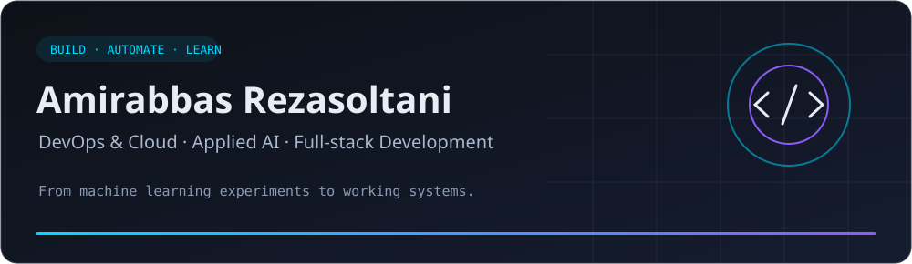
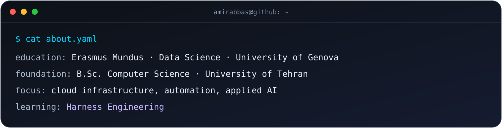
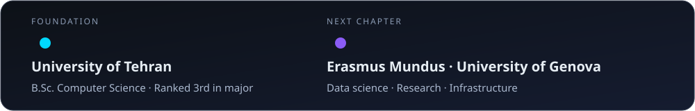
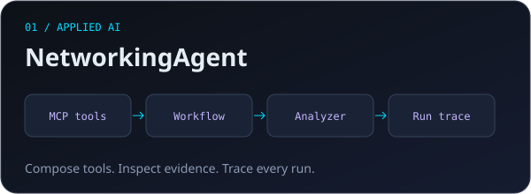
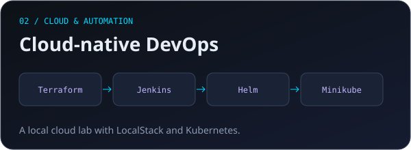
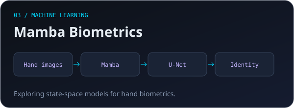
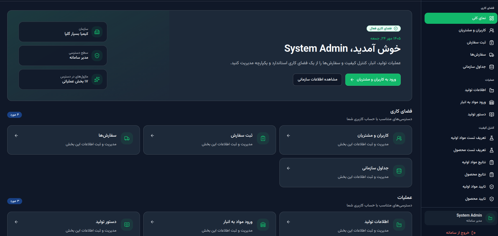

 

**Building across infrastructure, intelligent systems, and the web.**

 

  

 

## `$ whoami`

 

I'm **Amirabbas Rezasoltani**, a Computer Science graduate from the **University of Tehran** and an **Erasmus Mundus student at the University of Genova**, specializing in data science. I enjoy connecting machine learning, backend development, and infrastructure to build useful applications and understand how they run.

- ☁️ **Infrastructure & automation:** hands-on projects with Docker, Kubernetes, Terraform, Jenkins, and AWS tooling.
- 🧠 **Applied AI:** deep learning, computer vision, Mamba-based biometrics, and workflows that connect external AI services.
- 🛠️ **Applications:** Python APIs, React interfaces, and PostgreSQL-backed systems.
- 🌱 **Currently learning:** Kubernetes, Ansible, and Terraform.
- 💡 **Long-term interest:** building products that bring technical and business ideas together.

 

## 🧭 My path

<b>Education & achievements</b>

 

**Erasmus Mundus studies — University of Genova**

Specializing in data science, with interests spanning machine learning, software systems, and cloud infrastructure.

**B.Sc. in Computer Science — University of Tehran**

Ranked **3rd in the Computer Science major**. Coursework projects include deep learning, artificial intelligence, advanced programming, bio-computing, and game theory.

**Research**

Work on hand biometric identification using Mamba and U-Net architectures. A paper was accepted at the IKT Conference.

 

## 🚀 Featured projects

<table>
  <tr>
    <td width="50%" valign="top">
      
      <h3><a href="https://github.com/AmirSoltani2002/NetworkingAgent">NetworkingAgent · Local Meta-Harness</a></h3>
      
A local control plane for composing <b>allowlisted MCP tools</b>, an AI analyzer, optional retrieval, and validation. Build workflows and inspect evidence, outputs, errors, and recorded run traces. External MCP services provide the domain capabilities.

      
      
      
    </td>
    <td width="50%" valign="top">
      
      <h3><a href="https://github.com/AmirSoltani2002/myapp">Cloud-native DevOps Lab</a></h3>
      
A hands-on deployment project using <b>Terraform, Jenkins, Helm, and Minikube</b>. Uses LocalStack to explore AWS-style infrastructure locally, with a pipeline for building images, publishing artifacts, initializing the database, and deploying to Kubernetes.

      
      
      
    </td>
  </tr>
  <tr>
    <td width="50%" valign="top">
      
      <h3><a href="https://github.com/AmirSoltani2002/mamba">Mamba · Biometric Identification</a></h3>
      
Research exploring <b>Mamba state-space models and U-Net</b> for hand biometric identification. Includes training and validation code, with instructions for datasets and pretrained weights.

      
      
      
    </td>
    <td width="50%" valign="top">
      
      <h3><a href="https://github.com/AmirSoltani2002/KBG_frontend">KBG · Petrochemical ERP</a></h3>
      
A customized ERP system for a petrochemical company. A <b>React + TypeScript frontend</b> connects to my <b>kbg_backend</b> project for production and lot tracking, raw-material intake, quality control, certificates of analysis, orders, and user permissions in a Persian, right-to-left interface.

      
<a href="https://github.com/AmirSoltani2002/KBG_frontend">Frontend &amp; UI gallery</a> · <a href="https://github.com/AmirSoltani2002/kbg_backend">Backend</a>

      
      
      
    </td>
  </tr>
</table>

<b>More projects & coursework</b>

 

| Repository | Focus |
|:---|:---|
| [Deep Learning Projects](https://github.com/AmirSoltani2002/deeplearning_projs) | University of Tehran deep learning coursework |
| [Artificial Intelligence Projects](https://github.com/AmirSoltani2002/artificial_intelligence_projs) | AI coursework and problem solving in Python |
| [Computer Vision Tirana](https://github.com/AmirSoltani2002/Computer_Vision_Tirana) | Computer vision notebooks |
| [Advanced Programming Projects](https://github.com/AmirSoltani2002/advanced_programmig_Projs) | C++ programming projects |
| [Bio-computing](https://github.com/AmirSoltani2002/bio-computing) | Bio-computing final project |
| [Game Theory](https://github.com/AmirSoltani2002/game_theory) | Game theory final project |

 

## 🛠️ Technologies & tools

<table>
  <tr>
    <td width="160"><b>Cloud & DevOps</b></td>
    <td></td>
  </tr>
  <tr>
    <td><b>Languages</b></td>
    <td></td>
  </tr>
  <tr>
    <td><b>Web & data</b></td>
    <td></td>
  </tr>
  <tr>
    <td><b>Machine learning</b></td>
    <td> Also working with Pandas and NumPy.</td>
  </tr>
</table>

 

### Let's connect

I'm interested in conversations about **DevOps**, **cloud infrastructure**, **applied AI**, and **building useful software**.

 

